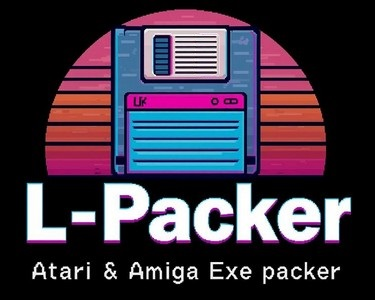
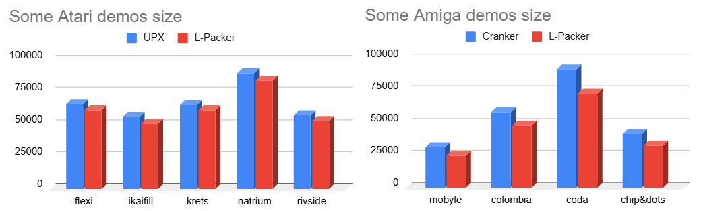

<p align="center">
  
</p>

# L-Packer 1.00

L-Packer is an executable compressor designed for 64K-style demos. Since I couldn’t choose between my two favorite platforms, L-Packer works on both Atari and Amiga systems!

## The Idea

If you’re targeting a 4K demo, nothing beats Shrinkler (Amiga) or STrinkler (Atari).

However, for 40K or 64K demos, Shrinkler’s decompression speed becomes a problem — it can take up to 30 seconds before your demo even starts. For that size range, Atari users often rely on UPX, while Amiga users use Cranker. Unfortunately, both offer relatively poor compression ratios.

So there was a gap to fill — something in between: a packer with good decompression speed without sacrificing too much compression efficiency.
That’s where the idea for L-Packer came from!

## Key Features

* Balances a good compression ratio with decent decompression speed
* Automatically tries three compression algorithms on your executable (DEFLATE, ZX0, and LZ4)
* Chooses the best algorithm for your target size (selecting the fastest depacker when possible)
* Supports both Atari and Amiga executables with a single tool
* Uses multi-threading to compress hunks with several algorithms in parallel for maximum speed
* Can pad the final executable with random bytes

## Use Case

If you can accept about 5% less compression than Shrinkler, L-Packer is perfect for you!
It consistently beats UPX and Cranker in compression ratio, and can decompress a 64K demo in about 3–5 seconds.



## Usage

````
L-Packer 1.00 - Atari & Amiga executable cruncher
Written by Arnaud Carré aka Leonard/Oxygene

Usage:
        L-Packer <src> <dst> [-options]
Options:
        -text <txt filename> : display a text during depacking
        -target <x> : target size limit in KiB (ex -target 64)
        -pad : add random bytes to pad up to the target size
        -flash : color flash when depacking
        -hwreg <hex> : flash hw reg (ex -hwreg 8240 (atari) or -hwreg 180 (amiga))
        -data : raw data mode (no executable)
        -deflate : include DEFLATE algorithm (by default)
        -zx0 : include ZX0 algorithm (by default)
        -lz4 : include LZ4 algorithm (by default)
        -v : verbose mode
````

## Examples

Pack `foo.exe` for the smallest output size:
````
  L-Packer foo.exe foo_packed.exe
````

Pack `Colombia.exe` for the 64 KiB demo category and pad the output to 64 KiB with random bytes:
````
  L-Packer Colombia.exe Colombia_packed.exe -target 64 -pad
````

## Versions

Version | Changes |
| :---- | :----
| 1.00 | Released the source code with Windows, macOS, and Linux support.<br>Added `-text <txt filename>` to display text during depacking on Amiga and Atari.<br>Added `-hwreg` to customize `-flash`. |
| 0.99 | Added support for selecting multiple packing algorithms. |
| 0.98 | Added `-data` mode. |
| 0.97 | Fixed the Atari bootstrap. |
| 0.96 | Fixed the `-pad` size calculation. |
| 0.95 | Added an error message when attempting to pack an executable already packed with L-Packer. |
| 0.94 | Fixed heap corruption in the Amiga version. |
| 0.93 | Added LZ4 compression and an option to force one of the three compression algorithms. |
| 0.92 | Added in-place depacking support for Amiga. |
| 0.91 | Added `-noflash`.<br>Fixed Atari in-place depacking crashes when no BSS was present.<br>Fixed BSS clearing on Amiga. |
| 0.90 | First public release. |

## Credits

* Code & concept by Arnaud Carré aka Leonard / Oxygene
* Zopfli DEFLATE compressor by Google
* Inflate 68k depacker by Keir Fraser
* ZX0 algorithm by Einar Saukas. “Salvador” ZX0 compressor & 68k decompressor by Emmanuel Marty
* LZ4 algorithm & compressor by Yann Collet. 68k decompressor by Arnaud Carré
